# ClinicDesk: DevOps Final Capstone

[](https://github.com/tanishkothari9/clinicdesk-devops-capstone/actions/workflows/ci-cd.yml)

**ClinicDesk** is a small appointment desk for an outpatient clinic. Front-desk staff register doctors, book patients into time slots, and move each visit through check-in → completed (or cancelled / no-show). Every request flows from a React UI through a FastAPI service into PostgreSQL. The backend refuses to double-book a doctor, and the dashboard shows today's schedule, load per doctor and the completion rate.

The application is my own domain. The DevOps layer follows the course architecture: Git → GitHub Actions (pytest, build, Trivy, GHCR) → Terraform (AWS VPC + EKS) → Helm on Kubernetes (Ingress, HPA) → Prometheus + Grafana, plus a troubleshooting lab.

| | |
|---|---|
| Student | Tanish Kothari |
| Repository | https://github.com/tanishkothari9/clinicdesk-devops-capstone |
| Pipeline run (green) | https://github.com/tanishkothari9/clinicdesk-devops-capstone/actions/runs/38907105678 |
| Images | `ghcr.io/tanishkothari9/clinicdesk-backend:<git-sha>`, `ghcr.io/tanishkothari9/clinicdesk-frontend:<git-sha>` |

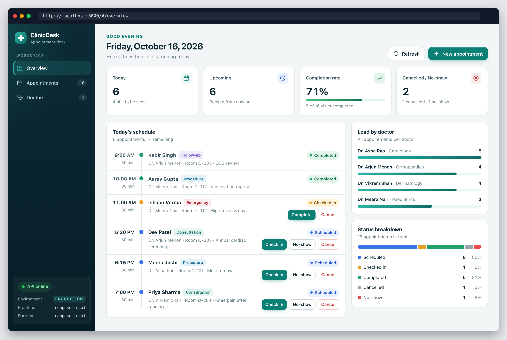

## Contents

1. [Architecture](#1-architecture)
2. [Repository layout](#2-repository-layout)
3. [M1: Application](#3-m1-application-frontend--backend--database)
4. [M2: Testing](#4-m2-testing-pytest)
5. [M3: Git and GitHub](#5-m3-git-and-github)
6. [M4: Docker](#6-m4-docker-dockerfiles--compose)
7. [M5: CI/CD](#7-m5-cicd-github-actions)
8. [M6: DevSecOps with Trivy](#8-m6-devsecops-trivy)
9. [M7: Terraform on AWS](#9-m7-terraform-aws-vpc--eks)
10. [M8: Kubernetes + Helm](#10-m8-kubernetes--helm)
11. [HPA](#11-horizontal-pod-autoscaler)
12. [M9: Observability](#12-m9-observability-prometheus--grafana)
13. [Troubleshooting lab](#13-troubleshooting-lab)
14. [M10: Live demo flow](#14-m10-live-demo-commit--pipeline--deployment)
15. [Submission checklist](#15-submission-checklist)

---

## 1. Architecture

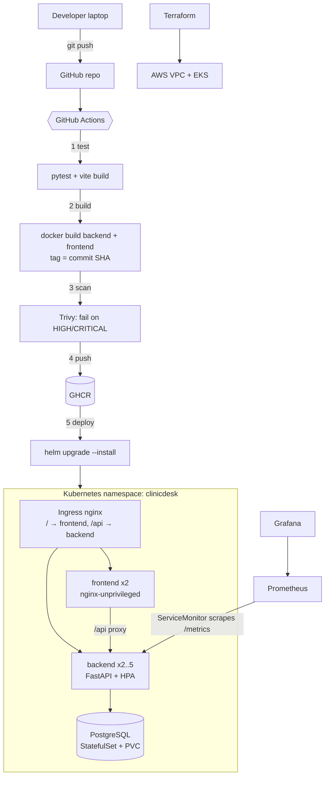

| Layer | Choice |
|---|---|
| Frontend | React 18 + Vite 5, plain responsive CSS, served by `nginxinc/nginx-unprivileged` |
| Backend | FastAPI, SQLAlchemy 2, Alembic, psycopg 3, `prometheus-fastapi-instrumentator` |
| Database | PostgreSQL 16 |
| Tests | pytest + FastAPI TestClient on an in-memory SQLite database |
| CI/CD | GitHub Actions → Trivy → GitHub Container Registry → Helm |
| Infrastructure | Terraform (`terraform-aws-modules/vpc` + `/eks`), region `ap-south-1` |
| Platform | Kubernetes, Helm, ingress-nginx, metrics-server, HPA |
| Observability | kube-prometheus-stack (Prometheus Operator + Grafana) |

## 2. Repository layout

```text
clinicdesk-devops-capstone/
├── backend/                  # FastAPI service
│   ├── app/                  # config, db, models, schemas, routers/
│   ├── alembic/versions/     # 0001 schema, 0002 demo doctors
│   ├── tests/                # 22 pytest cases
│   ├── Dockerfile            # non-root, runs migrations then uvicorn
│   └── entrypoint.sh
├── frontend/                 # React dashboard + nginx template
│   └── Dockerfile            # multi-stage: node build → nginx-unprivileged
├── docker-compose.yml        # postgres + backend + frontend
├── .github/workflows/ci-cd.yml
├── terraform/                # AWS VPC + EKS
├── k8s/namespace.yaml
├── helm/clinicdesk/          # chart: deployments, services, postgres, ingress, HPA, ServiceMonitor, dashboard
├── monitoring/               # kube-prometheus-stack values
├── troubleshooting/          # deliberately broken manifests
├── scripts/                  # deploy.sh, load-test.sh, seed-demo-data.py
└── docs/screenshots/
```

---

## 3. M1: Application (frontend + backend + database)

### Features

- **Overview:** today's schedule with one-click *Check in → Complete / Cancel / No-show*, KPI cards, load per doctor and a status breakdown.
- **Appointments:** filter by status, doctor and date. The table turns into cards on phones.
- **Doctors:** add or remove doctors. The API blocks deleting a doctor who still has appointments.
- **Business rule:** a doctor can't be double-booked. Overlapping slots return `409` with a readable message, back-to-back slots are fine, and a cancelled slot can be booked again.
- **States:** loading skeletons, empty states, and an "API offline" banner with Retry. The sidebar shows the running frontend and backend commit SHAs.

| Appointments | Doctors | Mobile (390px) |
|---|---|---|
| 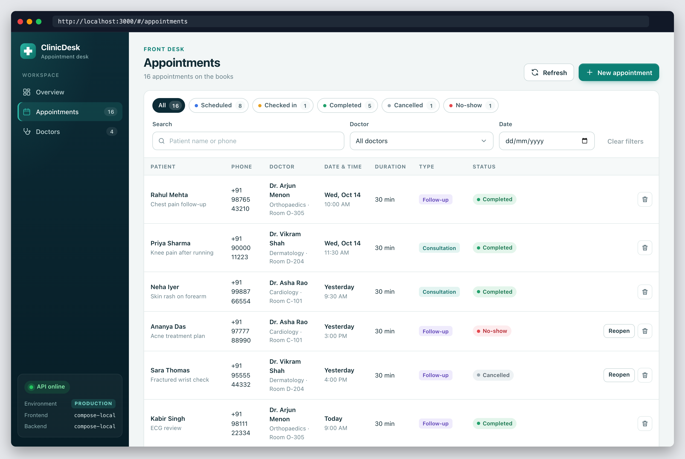 | 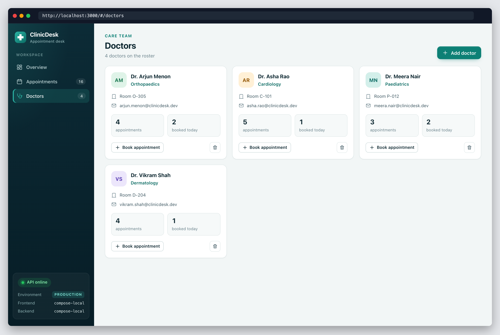 | 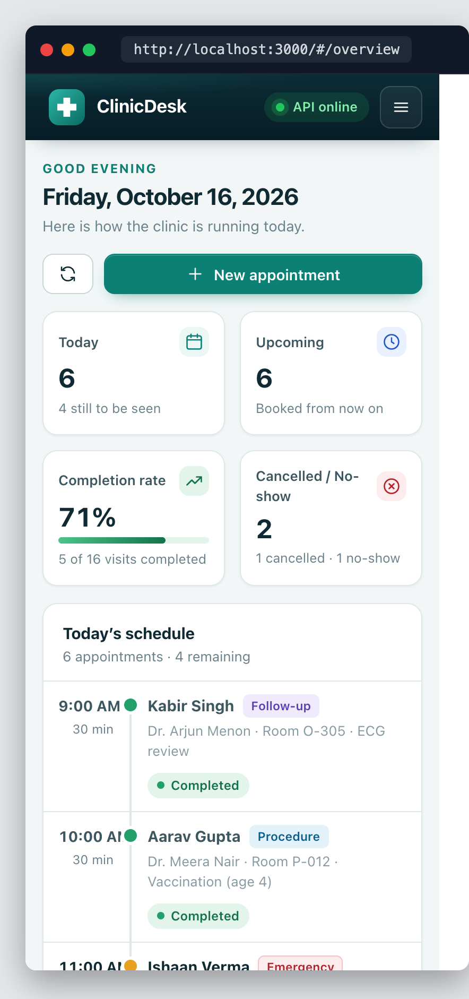 |

### REST API

| Method | Path | Purpose |
|---|---|---|
| GET | `/`, `/health`, `/api/health` | service info / liveness |
| GET | `/ready` | readiness: `SELECT 1` against Postgres, `503` if unreachable |
| GET | `/metrics` | Prometheus metrics |
| GET, POST | `/api/doctors` | list / create doctors |
| GET, PUT, DELETE | `/api/doctors/{id}` | read / update / delete (409 if the doctor has appointments) |
| GET, POST | `/api/appointments` | list (filters `status`, `doctor_id`, `date`) / book (409 on overlap) |
| GET, PUT, DELETE | `/api/appointments/{id}` | read / reschedule or change status / delete |
| GET | `/api/appointments/stats` | totals, today, upcoming, completion rate, by status, by doctor |

Swagger UI is at `/docs`:

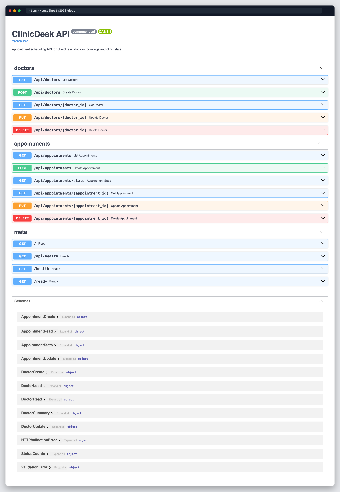

### Database and migrations

Alembic manages two tables: `doctors`, and `appointments` with a foreign key to `doctors`, check constraints on status, visit type and duration, and indexes on doctor, time and status.

- `0001` creates the schema.
- `0002` seeds four demo doctors, so a new environment is usable right away.

Every backend replica runs `alembic upgrade head` on start-up. The migration holds a **Postgres advisory lock** (`alembic/env.py`), so two pods starting together can't race each other. `entrypoint.sh` retries while Postgres is still booting.

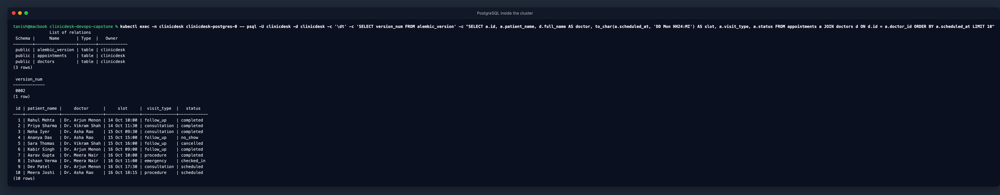

---

## 4. M2: Testing (pytest)

```bash
cd backend
python3.12 -m venv .venv && source .venv/bin/activate
pip install -r requirements-dev.txt
pytest -v
```

- **22 test cases** across `/health`, `/ready`, `/metrics`, `/api/doctors`, `/api/doctors/{id}`, `/api/appointments`, `/api/appointments/{id}` and `/api/appointments/stats`. They cover:
  - validation errors (422) and missing records (404)
  - double-booking and duplicate-email conflicts (409)
  - rescheduling into a taken slot, back-to-back slots and rebooking a cancelled slot
  - list filters and the stats maths
- **The tests never touch the real database.** `tests/conftest.py` overrides the `get_db` dependency with a fresh in-memory SQLite database (`StaticPool`) for every test.
- `pytest.ini` sets `testpaths`, `pythonpath`, and turns SQLAlchemy warnings into errors.

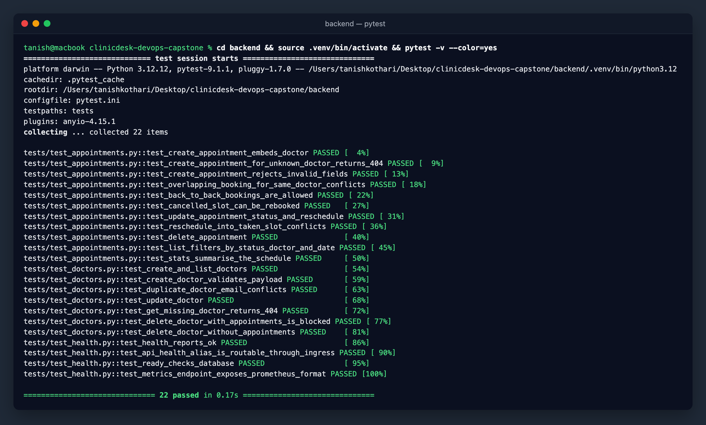

In CI, pytest is the first job. If it fails, no image is built or pushed.

---

## 5. M3: Git and GitHub

- Commits use conventional-commit messages (`feat(backend): …`, `ci: …`, `fix(backend): drop pip from runtime image to clear HIGH CVEs found by Trivy`).
- `.gitignore` excludes `.env*`, `__pycache__/`, `node_modules/`, `.venv/`, Terraform state and `*.tfvars`.
- `trivy fs --scanners secret` found no secrets in the repository. No AWS keys are committed: Terraform reads credentials from the local AWS profile.

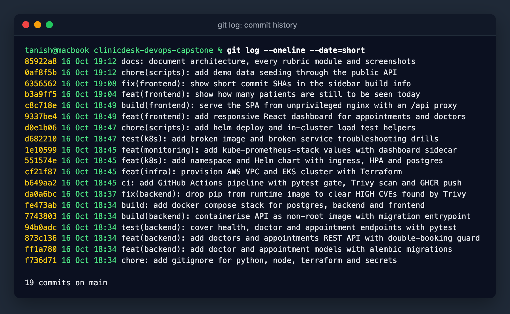

---

## 6. M4: Docker (Dockerfiles + Compose)

| Image | How it is built | Runs as |
|---|---|---|
| `backend/Dockerfile` | `python:3.12-slim`. OS packages are patched with `apt-get upgrade`, pip is removed after installing dependencies (see M6), and a `HEALTHCHECK` hits `/health` | `appuser` (uid **10001**) |
| `frontend/Dockerfile` | **Multi-stage:** `node:22-alpine` runs `npm ci && vite build` → `nginxinc/nginx-unprivileged:1.29-alpine` serves `dist/`. Alpine packages are patched and curl removed. The nginx config is a template, so `BACKEND_URL` works for both Compose and Kubernetes | `nginx` (uid **101**), port 8080 |

```bash
docker compose up --build        # http://localhost:3000 (UI), http://localhost:8000/docs (API)
python3 scripts/seed-demo-data.py   # optional: book a week of demo appointments
docker compose down -v           # stop and drop the database volume
```

Postgres has a `pg_isready` healthcheck, and the backend waits for it with `depends_on: condition: service_healthy`.

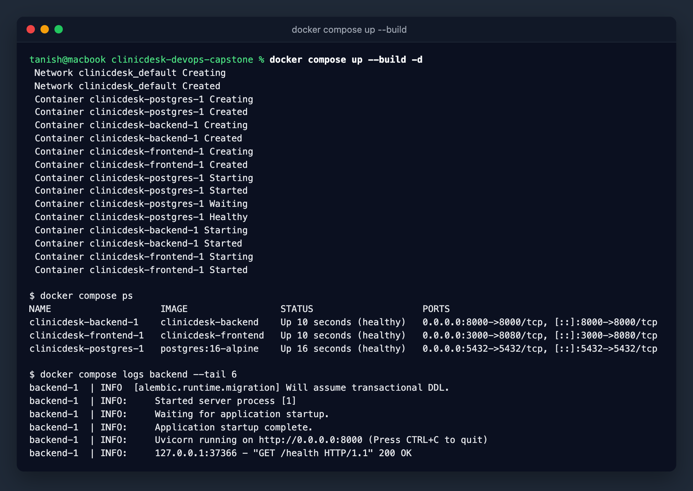

The application at `http://localhost:3000` is in the [M1 screenshots](#3-m1-application-frontend--backend--database) above.

---

## 7. M5: CI/CD (GitHub Actions)

[`.github/workflows/ci-cd.yml`](.github/workflows/ci-cd.yml) runs on every push and pull request to `main`, and on manual dispatch.

```text
test ──────────────► build-scan-push (matrix: backend, frontend) ──────────► deploy
pytest -v            docker build (tag = $GITHUB_SHA, gha layer cache)        helm upgrade --install
npm ci + vite build  Trivy: --severity HIGH,CRITICAL --exit-code 1            --set *.image.tag=$GITHUB_SHA
                     docker push ghcr.io/<owner>/clinicdesk-<component>:<sha>
```

- **Tests gate the images.** `build-scan-push` has `needs: test`, so a failing test stops the pipeline before anything is built.
- **Images are tagged only with the full commit SHA**, never `latest`. Every running pod traces back to one commit.
- **Pull requests build and scan but never push.**
- **The deploy job only runs when a cluster is configured.** It runs `helm upgrade --install` once a `KUBE_CONFIG_DATA` secret exists. Without it, the job skips with a notice instead of failing. The same Helm command lives in `scripts/deploy.sh` for clusters the runner can't reach (minikube on a laptop).
- **Trivy runs from the pinned `aquasec/trivy:0.76.0` image.** I deliberately didn't use a mutable third-party action tag.

Green run: https://github.com/tanishkothari9/clinicdesk-devops-capstone/actions/runs/38907105678

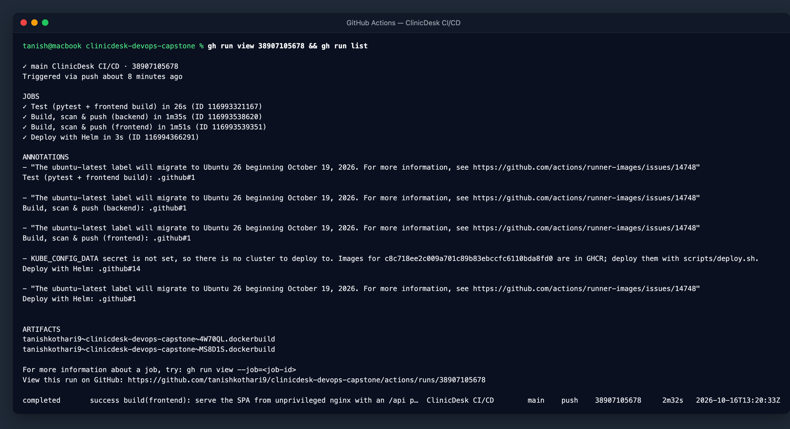

The images are pushed to GHCR with SHA tags (log of the *Push image to GHCR* step):

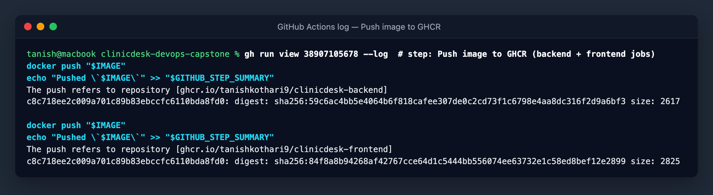

<!-- GHCR package page screenshot goes here: docs/screenshots/27-ghcr-packages.png -->

---

## 8. M6: DevSecOps (Trivy)

Trivy scans both images in the pipeline. `--severity HIGH,CRITICAL --ignore-unfixed --exit-code 1` fails the build if any HIGH or CRITICAL vulnerability with an available fix is present.

**What Trivy found and what I changed.** The first scan of the backend image failed with four HIGH findings, all in packaging tooling that the API never uses at runtime:

- **GHSA-6v7p-g79w-8964:** msgpack, out-of-bounds read
- **CVE-2026-97687 and CVE-2026-97689:** urllib3, TLS override via HTTPS proxy, and unbounded memory allocation in the chunk parser (DoS)
- **CVE-2025-47273:** setuptools, path traversal in `PackageIndex`

msgpack and urllib3 were vendored inside pip. CVE-2026-97689, for example, lets a malicious server make urllib3 allocate memory without limit while parsing a chunked response, which can crash the process. That only matters if something runs pip or urllib3 inside the container, and nothing should. So the fix was not to pin newer versions but to **remove pip and setuptools from the runtime image** after installing dependencies (commit `fix(backend): drop pip from runtime image…`). That shrinks the attack surface instead of chasing versions.

The frontend's first scan reported **43 HIGH** findings in Alpine packages of the nginx base image: curl/libcurl, OpenSSL, expat, pcre2, libuuid and others. Adding `apk upgrade` and removing curl cleared them.

The pipeline's scans are now clean: 0 HIGH or CRITICAL in the Debian 13 packages and every Python package of the backend, and the same for the Alpine frontend.

| Before the fix (local scan of commit `7743803`) | In the pipeline after the fix |
|---|---|
| 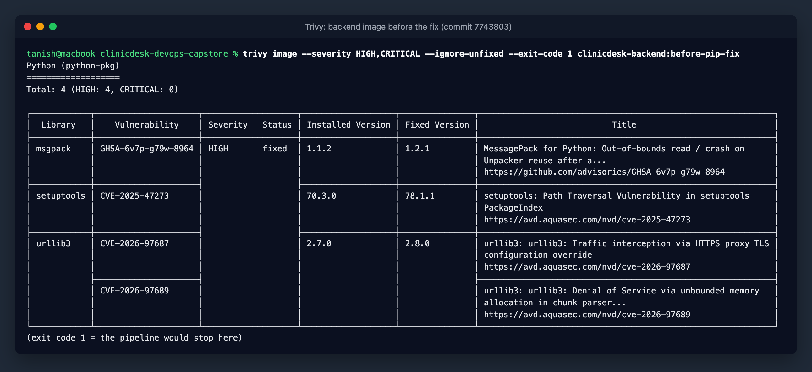 | 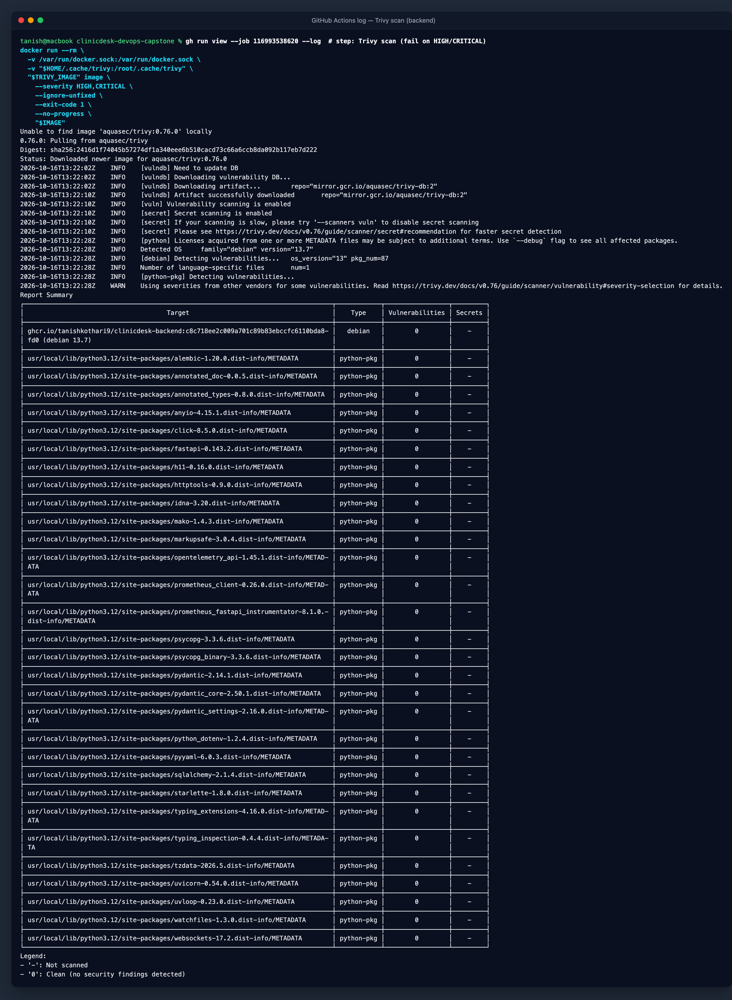 |

Frontend scan in CI:

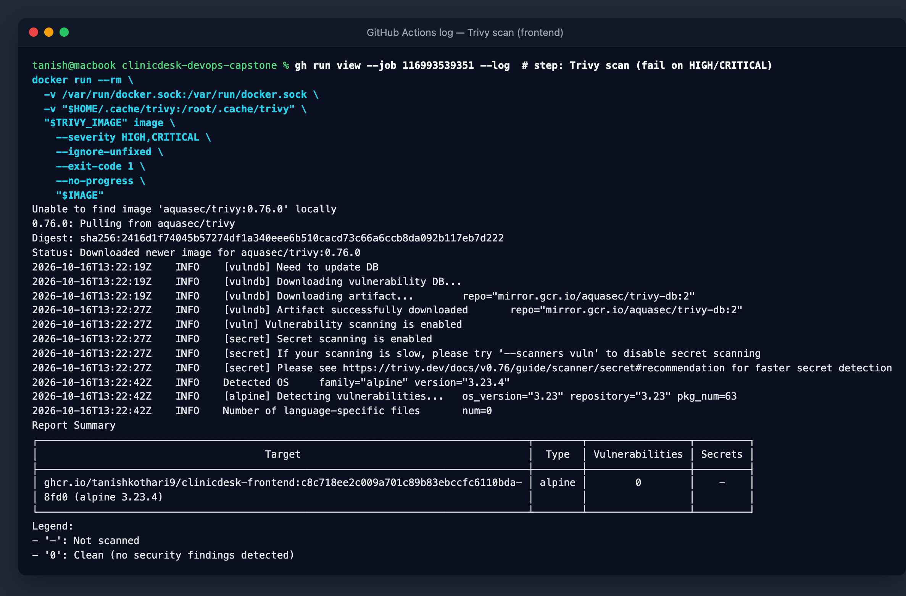

---

## 9. M7: Terraform (AWS VPC + EKS)

[`terraform/`](terraform) provisions, in `ap-south-1`:

| Resource | Details |
|---|---|
| VPC | `10.42.0.0/16`, DNS hostnames on (`terraform-aws-modules/vpc ~> 6.7`) |
| Subnets | **2 public** (`10.42.0.0/24`, `10.42.1.0/24`) and 2 private (`10.42.10.0/24`, `10.42.11.0/24`) in two AZs, tagged for ELB discovery |
| NAT | a single NAT gateway, to keep costs down |
| EKS | cluster `clinicdesk-eks`, Kubernetes 1.35, public endpoint, creator gets cluster-admin (`terraform-aws-modules/eks ~> 21.29`) |
| Node group | managed `t3.medium` nodes, AL2023, min 1 / desired 2 / max 3 |
| Add-ons | vpc-cni, kube-proxy, coredns, eks-pod-identity-agent, and aws-ebs-csi-driver with a Pod Identity role, so the Postgres PVC gets an EBS volume |

```bash
cd terraform
cp terraform.tfvars.example terraform.tfvars   # optional overrides; no credentials go in here
terraform init
terraform fmt -check -recursive && terraform validate
terraform plan -out=tfplan
terraform apply tfplan
aws eks update-kubeconfig --region ap-south-1 --name clinicdesk-eks
VALUES=helm/clinicdesk/values-prod.yaml ./scripts/deploy.sh <git-sha>
terraform destroy                               # always, after the demo
```

> Cost: EKS control plane + one NAT gateway + two t3.medium nodes come to roughly USD 0.25–0.30 per hour in ap-south-1. Destroy as soon as the screenshots are taken.

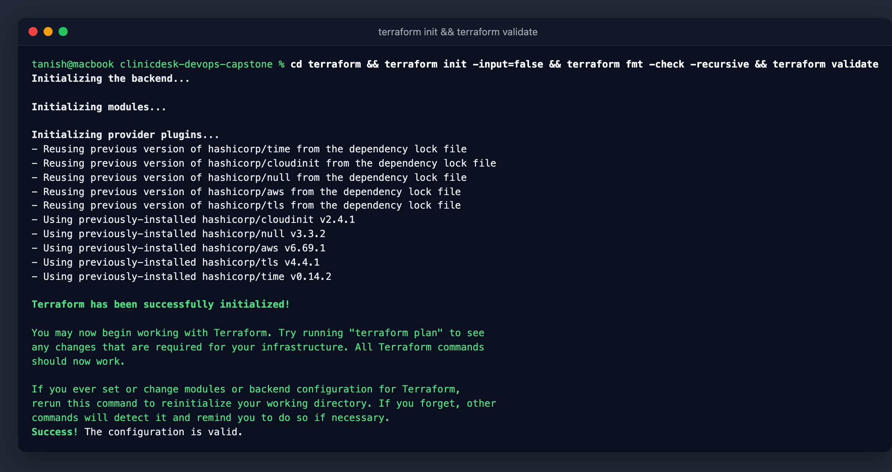

`terraform plan`: **60 resources to add, 0 errors**. This view is filtered to the resource list; the full plan is in the terminal.

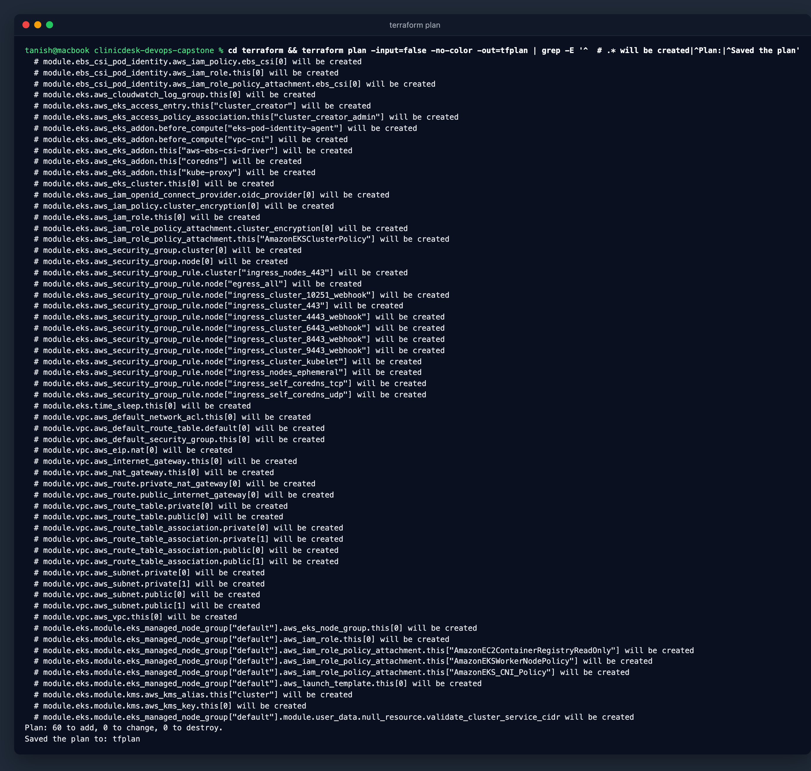

### Apply → verify → destroy

The stack was applied with a dedicated, temporary IAM user (`clinicdesk-capstone`) and torn down right after the screenshots were taken.

`terraform apply`: **60 added**. The EKS control plane took 8m25s and the managed node group 1m28s.

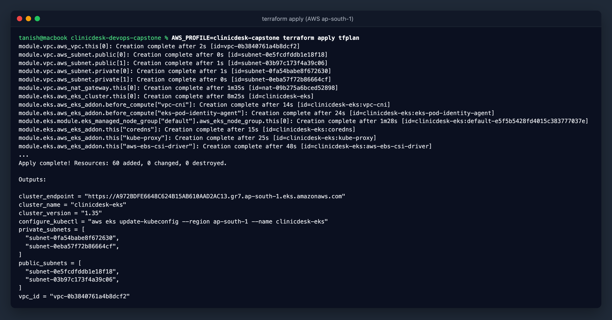

`kubectl` against the new cluster: 2 × t3.medium nodes `Ready` in two AZs, the add-ons running (VPC CNI, CoreDNS, kube-proxy, Pod Identity agent, EBS CSI driver), cluster `ACTIVE`, and 2 public + 2 private subnets:

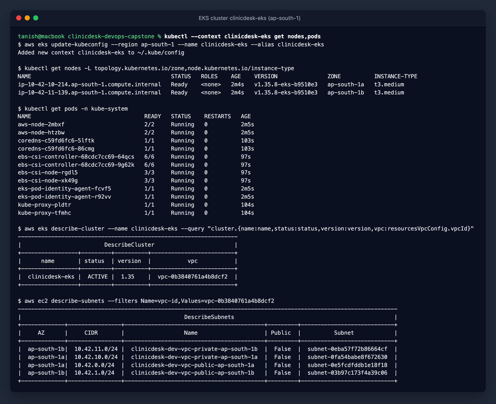

AWS Console, `ap-south-1`: EKS cluster `clinicdesk-eks` is Active on Kubernetes 1.35.

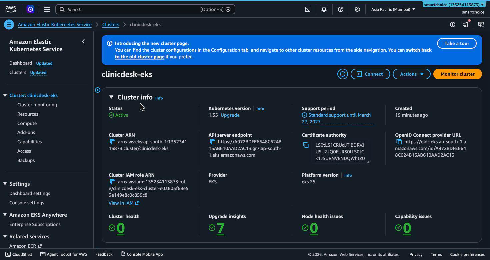

AWS Console: VPC `clinicdesk-dev-vpc` (`10.42.0.0/16`) and its resource map. It has a public and a private subnet in each of `ap-south-1a` and `ap-south-1b`, plus public and private route tables:

| VPC details | Resource map |
|---|---|
| 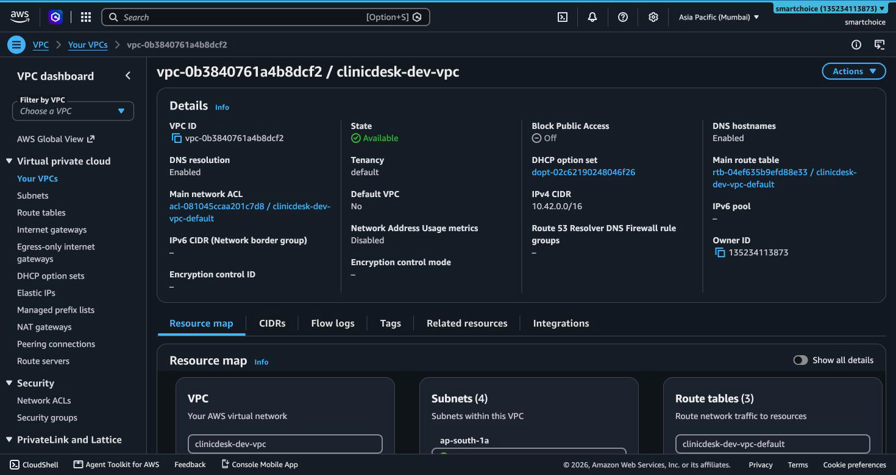 | 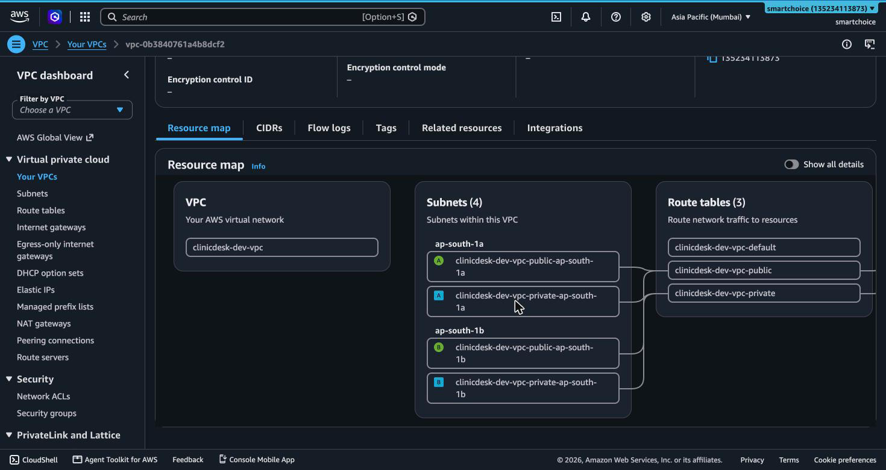 |

`terraform destroy`: everything removed, so no AWS resources are left running.

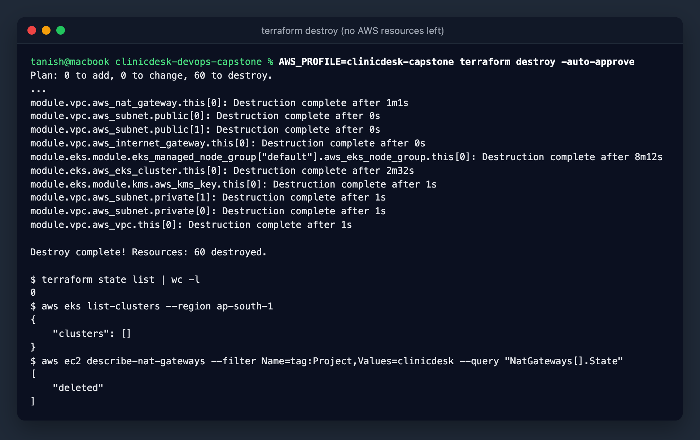

---

## 10. M8: Kubernetes + Helm

The cluster used for the screenshots is a local **minikube** with the `ingress` and `metrics-server` add-ons. The same chart targets EKS through `values-prod.yaml` (gp2 storage, more replicas).

```bash
minikube start -p clinicdesk --cpus=4 --memory=5g --addons=ingress --addons=metrics-server
kubectl apply -f k8s/namespace.yaml
./scripts/deploy.sh <git-sha>     # helm upgrade --install clinicdesk ./helm/clinicdesk -f values-dev.yaml --set *.image.tag=<sha>
```

Chart highlights (`helm/clinicdesk`):

- **Workloads:**
  - backend and frontend `Deployment`s with 2 replicas each, rolling updates (`maxUnavailable: 0`), `runAsNonRoot`, all capabilities dropped and resource requests/limits
  - **startup, liveness and readiness probes**: backend on `/health` and `/ready`, frontend on `/nginx-health`
- **Database:** PostgreSQL `StatefulSet` with a `volumeClaimTemplate`. The password is generated once and kept across upgrades via Helm `lookup`.
- **Networking:** `ClusterIP` Services for backend, frontend and Postgres. The `Ingress` (class `nginx`, host `clinicdesk.local`) routes `/api`, `/docs` and `/openapi.json` → backend and `/` → frontend.
- **Scaling and monitoring:** `HorizontalPodAutoscaler`, a `ServiceMonitor`, and the Grafana dashboard as a labelled `ConfigMap`.

| Namespace | Helm install |
|---|---|
| 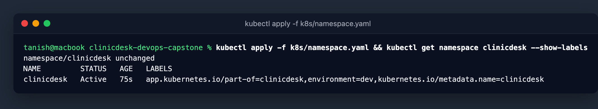 | 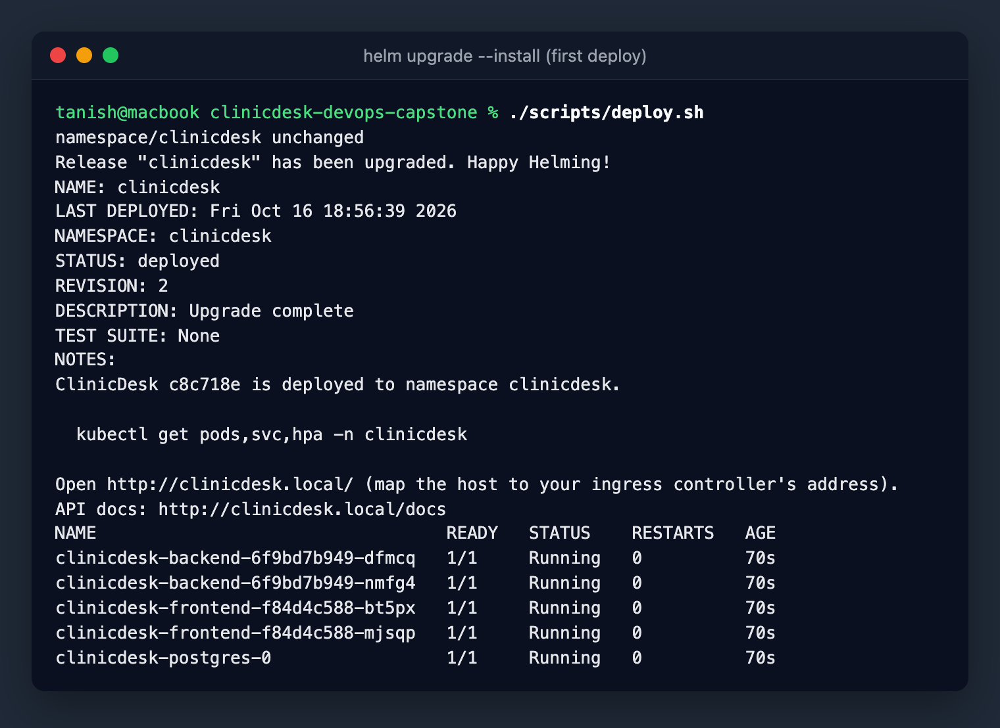 |

`kubectl get pods`: every pod is `Running`.

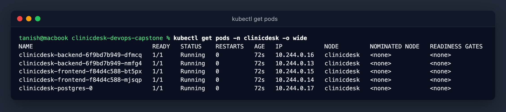

`kubectl get svc` (and their endpoints):

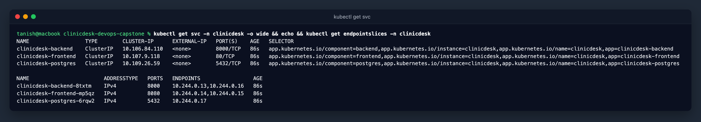

`helm list` and release history:

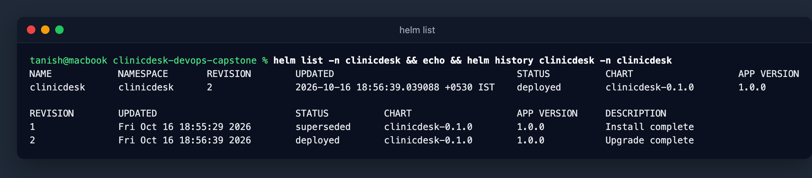

Ingress rules:

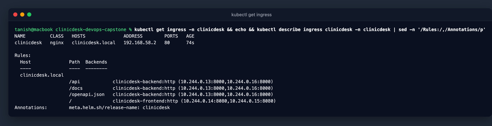

The application through the Ingress hostname `clinicdesk.local`, via `kubectl port-forward` of the ingress-nginx controller to port 8088, because the minikube docker driver on macOS doesn't expose the node IP:


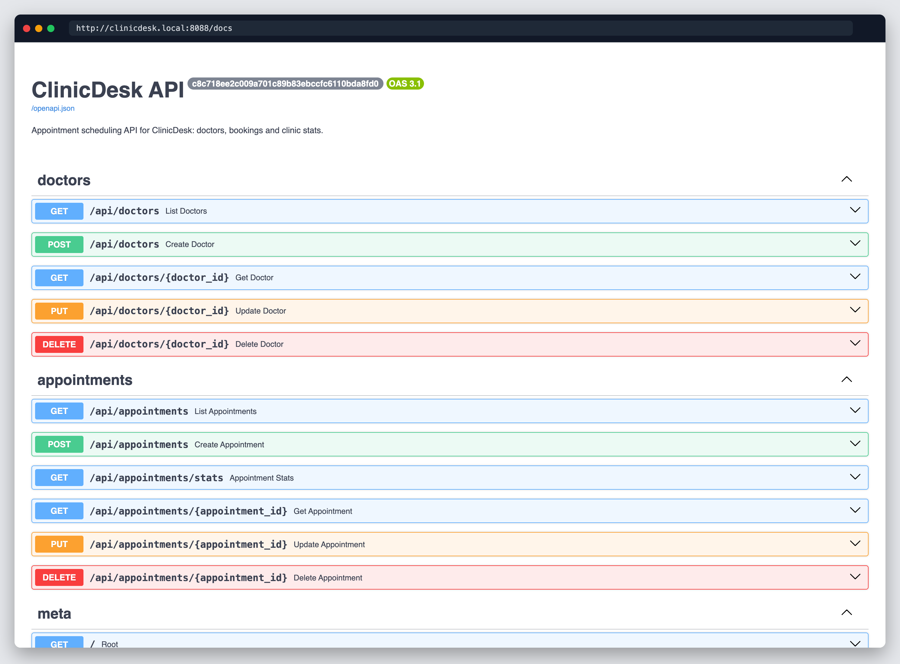

---

## 11. Horizontal Pod Autoscaler

The backend HPA targets 60% CPU (requests are 100m) and scales between 2 and 5 replicas, with a 60s scale-down stabilisation window. `scripts/load-test.sh` starts a busybox pod inside the cluster with 12 parallel workers hitting `/api/appointments/stats`. The HPA went from **2 to 5 replicas** at 144% CPU.

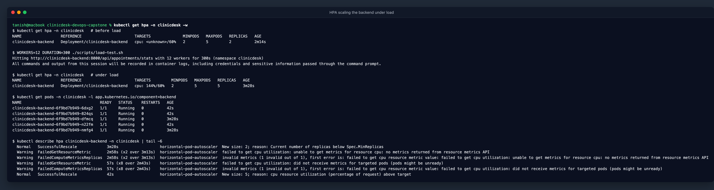

---

## 12. M9: Observability (Prometheus + Grafana)

```bash
helm repo add prometheus-community https://prometheus-community.github.io/helm-charts
helm upgrade --install kube-prometheus-stack prometheus-community/kube-prometheus-stack \
  -n monitoring --create-namespace -f monitoring/kube-prometheus-stack-values.yaml
```

- **Metrics:** the backend exposes request counts and latency histograms per endpoint, method and status class at `/metrics`.
- **Scraping:** the chart's `ServiceMonitor` tells the Prometheus Operator to scrape every backend pod every 15s. The values file makes Prometheus pick up ServiceMonitors from all namespaces.
- **Dashboard:** the Grafana sidecar loads the `ClinicDesk API` dashboard from a ConfigMap shipped in the Helm chart. Its panels:
  - requests per second, 5xx ratio, p95 latency and ready backend pods
  - requests and p95 latency per endpoint, and responses by status class
  - CPU per backend pod, and HPA current vs desired replicas

`/metrics` output:

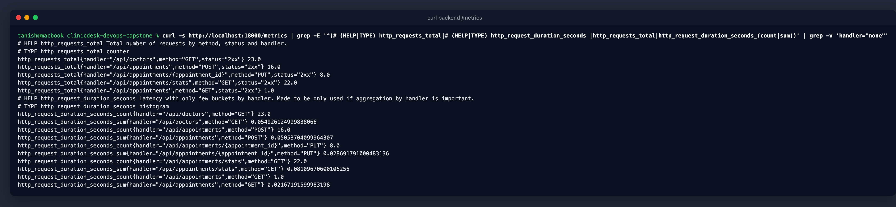

Prometheus targets: every backend pod `UP`, including the ones the HPA added:

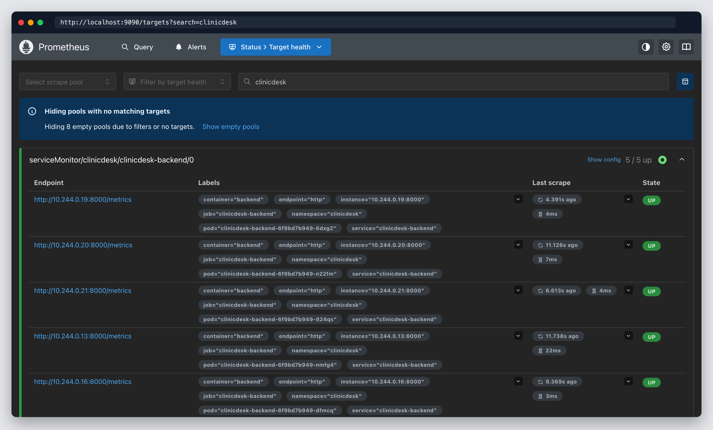

Grafana during the load test (about 300 req/s, 0% errors, the HPA at 5 pods):

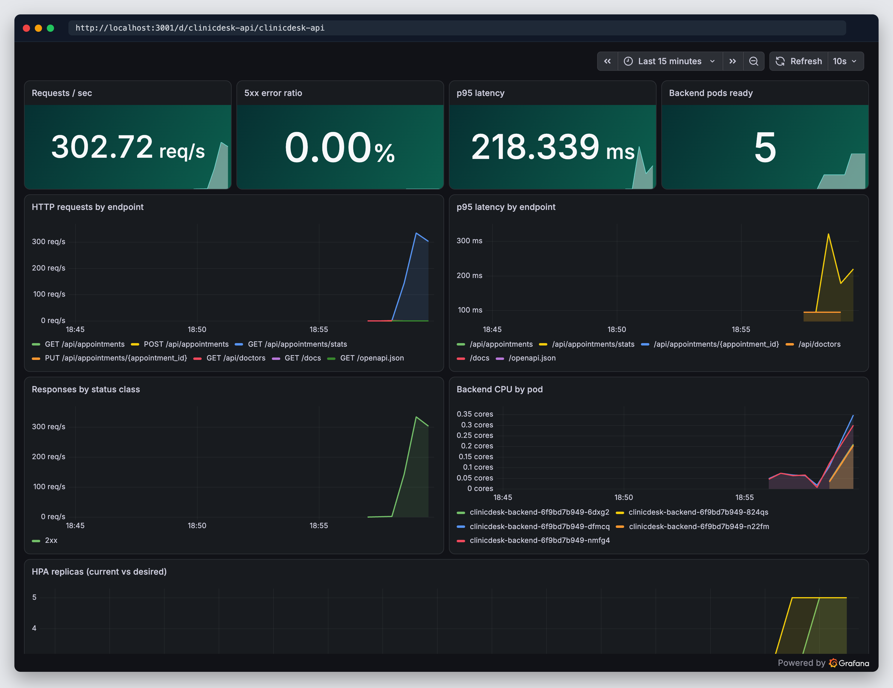

---

## 13. Troubleshooting lab

### Drill 1: broken image (`troubleshooting/broken-image.yaml`)

A Deployment points at `clinicdesk-backend:v9.9.9-does-not-exist`.

- **Investigation:** `kubectl get pods` shows `ImagePullBackOff`. `kubectl describe pod` and the events show `Failed to pull image … not found`: the tag was never pushed.
- **Fix:** point the Deployment at a tag that CI actually built (a commit SHA). The rollout then completes.

| Symptom and investigation | Fix |
|---|---|
| 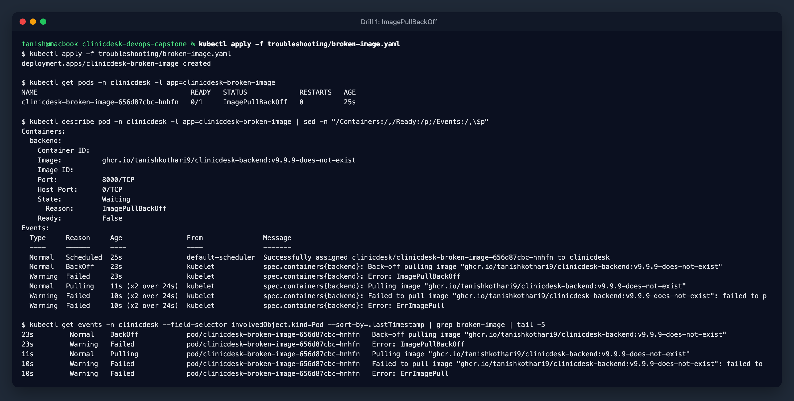 | 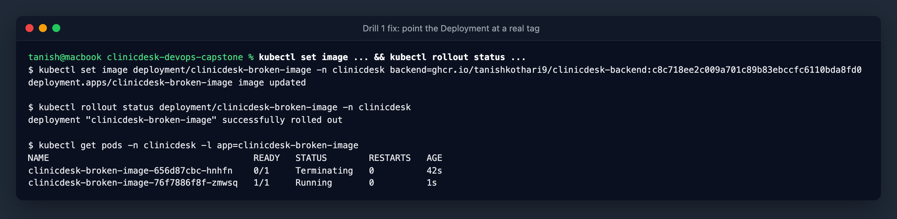 |

### Drill 2: broken Service (`troubleshooting/broken-service.yaml`)

A Service selects `app=clinicdesk-backned`, which has a typo.

- **Investigation:** requests to it fail with *connection refused*, and its EndpointSlice has no endpoints. Comparing with `kubectl get pods -L app` shows the pods are labelled `app=clinicdesk-backend`.
- **Root cause:** a Service routes only to pods whose labels match its selector. No match means no endpoints, which means no traffic.
- **Fix:** correct the selector. Endpoints appear and `/health` answers.

| Symptom and investigation | Fix |
|---|---|
| 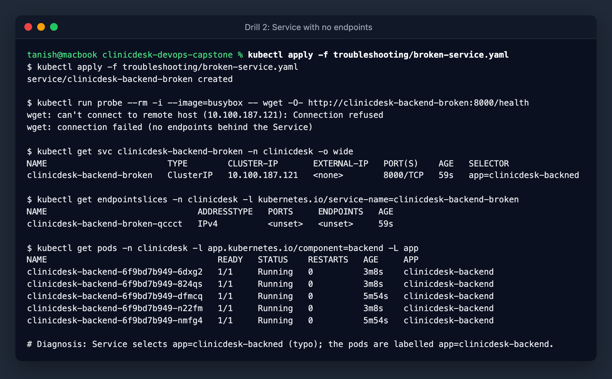 | 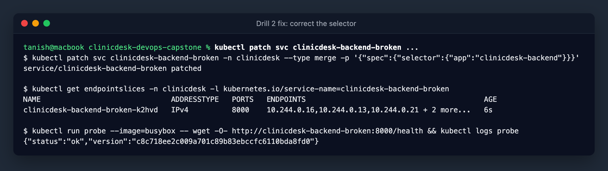 |

---

## 14. M10: Live demo (commit → pipeline → deployment)

1. Change the app. Here there are two changes:
   - `b3a9ff5`: the Overview subtitle now shows how many patients are still to be seen
   - `6356562`: the sidebar shows short commit SHAs instead of overflowing with the full 40-character one
2. `git commit` and `git push` to `main`.
3. GitHub Actions runs pytest → build → Trivy → push `:<new-sha>` to GHCR ([run 38908916603](https://github.com/tanishkothari9/clinicdesk-devops-capstone/actions/runs/38908916603), [run 38909437524](https://github.com/tanishkothari9/clinicdesk-devops-capstone/actions/runs/38909437524)).
4. `./scripts/deploy.sh <new-sha>` (or the deploy job, when `KUBE_CONFIG_DATA` is set) runs `helm upgrade`. Kubernetes rolls the pods with zero downtime (`maxUnavailable: 0`), and the sidebar shows the new commit. `helm history` shows each revision, so `helm rollback clinicdesk <rev>` can undo a bad release.

| Before (`c8c718e`) | After the pipeline and Helm upgrade (`6356562`) |
|---|---|
|  | 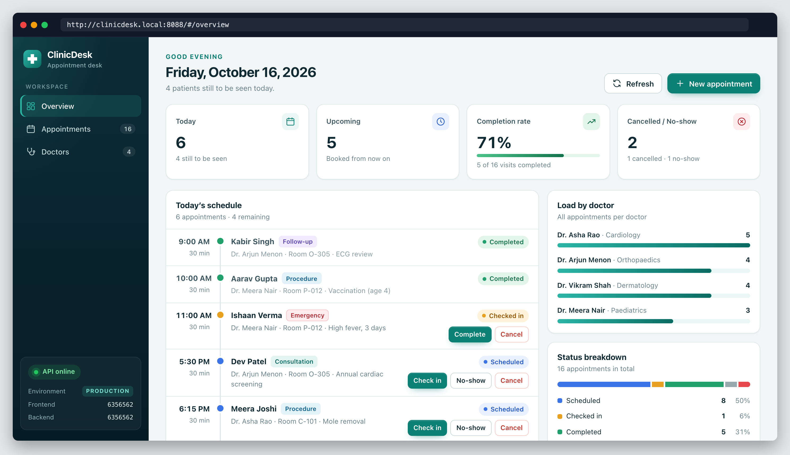 |

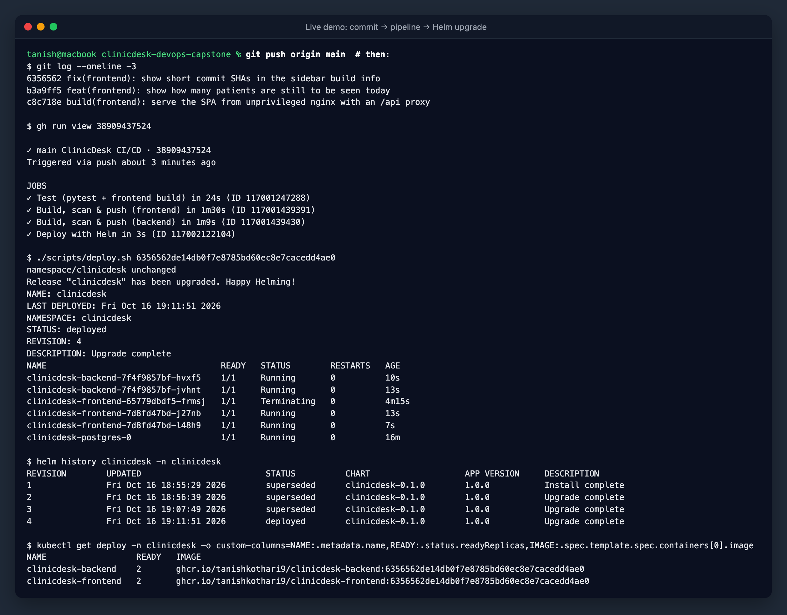

---

## 15. Submission checklist

| Item | Evidence |
|---|---|
| Application runs via `docker compose up --build` | §6 |
| ≥ 4 REST endpoints, Alembic migration | §3 (`backend/alembic/versions/`) |
| pytest passes, ≥ 5 tests | §4: 22 tests |
| Non-root, multi-stage Dockerfiles | §6 |
| Workflow on push to `main`; pytest, frontend build, both images, GHCR, SHA tags | §7 |
| Trivy in the pipeline, fails on HIGH/CRITICAL; findings explained | §8 |
| `terraform init/validate/plan` | §9 |
| VPC + EKS applied (AWS Console) and `terraform destroy` | §9 |
| Namespace, Helm chart, pods Running, Services, `helm list`, Ingress | §10 |
| HPA | §11 |
| `/metrics`, Prometheus target `UP`, Grafana dashboard | §12 |
| Troubleshooting | §13 |
| README + live demo flow | this file, §14 |
